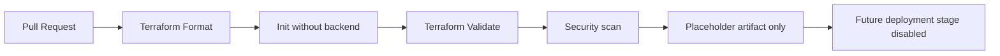

# Azure DevOps Infra Pipelines

This repository is a practical Azure DevOps reference for infrastructure CI/CD workflows. It is intentionally focused on reusable templates, safe validation, and environment-specific promotion conventions without storing secret values or real Azure backend details in source control.

## What is implemented here

This repo currently implements the following checks:

- Pull-request validation for Terraform formatting, initialization, and validation
- tfsec scanning for Terraform configuration files
- Trivy configuration scanning for Terraform content
- A disabled future deployment stage that is intentionally not active
- A placeholder artifact that is clearly labeled as non-production content only

## What is not implemented here

This repository does not contain or enable any of the following:

- A real Azure deployment stage
- A real service connection or credentialed deployment target
- A live production approval flow
- Real Terraform remote-state configuration in source control
- A real Terraform plan artifact intended for production use

The approval template is a reusable example only and is not an active production approval control in this repository.

## Pipeline architecture



## Included templates

- Terraform validation with explicit Terraform versioning
- Security scanning with pinned tool versions
- Manual approval gate example for future deployment workflows
- Guidance for environment separation, state handling, and least-privilege service connections

## Repository conventions

- `azure-pipelines.yml` is the main reference pipeline for pull-request validation.
- `templates/terraform-validate.yml` contains reusable Terraform validation steps.
- `templates/terraform-security.yml` contains policy and security scanning steps.
- `templates/release-gate.yml` is a manual approval example; it is not active in this repository.
- Production or environment-specific deployment logic remains disabled by design and should not be enabled in this repo without real environment configuration.

## Safe validation guidance

Use the pipeline templates as a pattern for repositories that contain Terraform code, but keep these rules in force:

- Do not commit real Azure credentials, backend storage account names, or Terraform state values.
- Use Azure DevOps service connections and variable groups for non-source-controlled secrets.
- Keep `terraform init` in `-backend=false` mode for local validation and PR checks.
- Separate pull-request validation from deployment stages so only approved infrastructure changes can reach higher environments.
- Do not use this repository to perform Azure deployment commands; it is a reference project only.

## Recommended enterprise configuration guidance

The following practices are recommended for the real Terraform deployment repository but are not implemented here:

- Protect `main` with required pull request reviews.
- Require pipeline validation to pass before merge.
- Restrict direct pushes to protected branches.
- Use one service connection per environment with minimal permissions.
- Prefer environment-scoped RBAC instead of broad subscription-wide access.
- Require approvals for production promotion.
- Keep remote-state values in secure pipeline variables, environment-scoped secret stores, or Azure Key Vault-backed configuration rather than source control.

## Remote state setup guidance

Use a secure remote backend only in the target Terraform repository, not in this reference repository. For example:

```hcl
terraform {
  backend "azurerm" {
    resource_group_name  = "rg-tfstate"
    storage_account_name = "tfstateexample"
    container_name       = "tfstate"
    key                  = "platform/dev.terraform.tfstate"
  }
}
```

Keep the real values in Azure DevOps variable groups, pipeline variables, or secure pipeline secret files, never in source control.

## Troubleshooting

- If Terraform validation fails, confirm the repository contains a valid Terraform configuration and a compatible Terraform version.
- If backend configuration is required, use a secure pipeline variable or `-backend-config` file, not committed storage values.
- If security tools fail, inspect the specific rule and decide whether the issue is a genuine policy violation or a required exception.
- If no Terraform configuration is present, the validation steps intentionally skip execution with a clear log message because this repository is a template reference project.

## Security notice

This repository is a reference implementation. It does not contain live credentials and should not be used for hosted Azure deployment validation. The future deployment stages are intentionally disabled and the approval gate is presented only as an example pattern.
