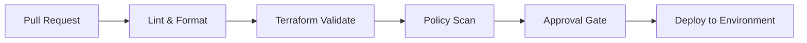

# Azure DevOps Infra Pipelines

This repository provides Azure DevOps pipeline templates for Terraform validation, policy checks, and release promotions across Azure landing zones.

## Pipeline architecture

## Included templates

- Terraform validation
- Policy and governance checks
- Approval gate and promotion workflow
